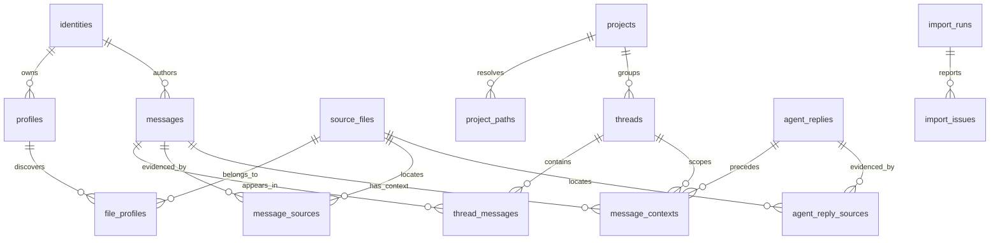

# Database design

SQLite is appropriate for the first step: this is one person's local, read-heavy archive, and a single file is easy to inspect, back up, and query with Python. WAL mode allows the browser to read while an import commits complete source files. Foreign keys preserve relationships, and FTS5 indexes message text.



| Table | Purpose |
| --- | --- |
| `identities` | Exactly one person: you. Profile accounts never become separate people. |
| `profiles` | Provider and discovered source root, retained as provenance. A backup collection is also a source root; this count is not a count of paid subscriptions. |
| `projects` | Canonical project path and display name. |
| `project_paths` | Original working-directory paths and the method used to resolve them. |
| `threads` | Provider-native thread ID, project, title, working directory, parent ID, agent status, and date range. |
| `messages` | One original user action: stable ID, provider-native event ID, full text, sanitized content blocks, UTC timestamp and raw timestamp, human/review classification, reason, and first import time. |
| `thread_messages` | Many-to-many membership so an inherited message can be visible in multiple threads without being counted as another action. Source order breaks equal-time ties within each thread. |
| `source_files` | Real path, provider, file hash, size, modification time, import counts, skipped-reason counts, malformed count, and error state. |
| `file_profiles` | Records which profile paths reference a file, including shared physical files. |
| `message_sources` | Original JSONL line, record hash, source snapshot hash, and whether that location is still in the latest imported revision. Copies and earlier source revisions remain traceable. |
| `agent_replies` | Original final response text, native event/message ID, provider, UTC/raw timestamps, completion evidence, and first import time. Different text versions are retained separately. |
| `agent_reply_sources` | Exact source lines/hashes for an extracted response, including multiple text fragments and earlier file revisions. |
| `message_contexts` | One context observation per human/review message, thread, source file, and source revision. Holds the previous-reply reference or an explicit missing/interrupted-context status. |
| `preferred_message_contexts` | View selecting the strongest available context for each message/thread pair; complete evidence takes priority over weaker copies. Previously captured context survives source compaction. |
| `import_runs` / `import_issues` | Start/end time, result, aggregate counts, inaccessible sources, malformed records, and partial final lines. |
| `messages_fts` | Full-text index maintained by SQLite triggers. |

`messages.primary_thread_id` supplies a stable representative when browsing all projects; `thread_messages` is the complete membership relation. Claude UUIDs identify events globally within the provider. Codex identifiers are scoped by provider **and thread** because names such as `item-14` repeat across conversations. Codex final-response IDs also include their native thread and timestamp. IDs from Claude and Codex occupy different namespaces. Threads are keyed by provider plus native thread ID. Legacy missing-ID fallbacks include enough event information to distinguish repeated submissions.

Project and thread counts can include the same inherited message in more than one place. The global message count counts unique actions. A project's timeline also counts a shared event once within that project. Review candidates never contribute to human-only counts.

Importing a compacted/replaced file does not destroy already archived actions. Old source locations are marked `is_current=0`; current records get the new snapshot hash. The transcript itself remains the source of truth. This database is an extracted archive rather than a backup of all original tool/assistant output or binary attachments.

Human classifications can be strengthened when a copied event has better evidence. The current importer does not automatically downgrade an existing human classification to review; rebuilding into a separate database with the current parser gives a clean classification audit after major rule changes.

Final responses are stored separately from human messages and do not contribute to the human message count or human-text search index. Context selection follows source order within a thread and checks available timestamps to avoid showing a future response. It selects original final text rather than asking a model to summarize or interpret it. Missing replies remain null with a reason. Context is scoped by thread because the same native human UUID can appear in a fork under a different preceding response.

The context tables in schema version 2 are additive. The importer also repairs legacy globally scoped Codex IDs, retaining original primary actions and rescanning sources to recover distinct actions that shared a local item ID. It discards invalid cross-thread memberships/context from those old collisions. Claude message IDs remain unchanged. A per-source context-parser version triggers the initial rescan even when the file's size and modification time are unchanged.

Example chronological query:

```sql
SELECT p.name AS project, t.title AS thread, m.sent_at, tm.ordinal,
       m.provider, m.text, m.classification_reason
FROM messages m
JOIN thread_messages tm ON tm.message_id = m.id
JOIN threads t ON t.id = tm.thread_id
JOIN projects p ON p.id = t.project_id
WHERE m.origin = 'human' AND t.project_id = :project_id
ORDER BY m.sent_at IS NULL, m.sent_at, t.id, tm.ordinal, m.id;
```

For later playbook work, add candidate requirements, user-approved requirements, and a requirement-to-message evidence relation. Keep the original messages immutable as evidence and distinguish an agent's suggested rule from one you have approved. This build establishes the evidence archive; it does not yet claim to know your universal app requirements.
